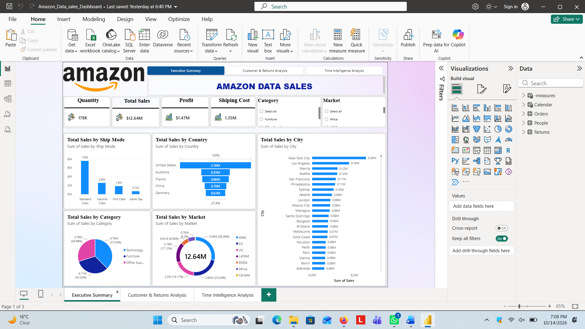
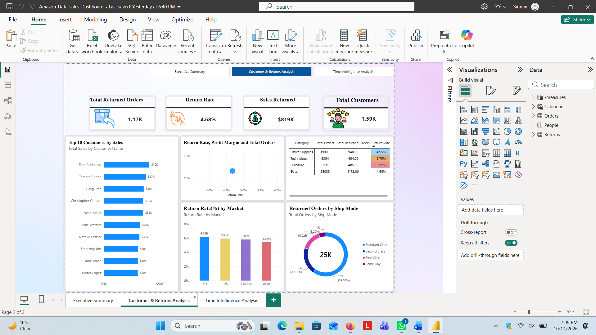
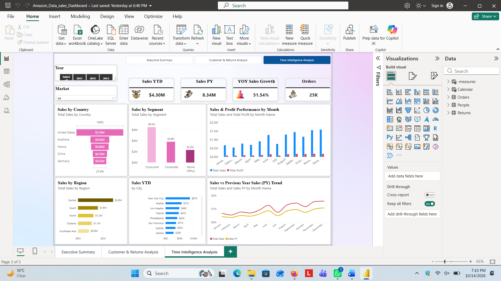

# 🛒 Amazon Global Data Sales & Return Analytics Dashboard

An interactive multi-page Power BI dashboard designed to analyze end-to-end sales performance, profit margins, customer behavior, return dynamics, and year-over-year (YoY) time intelligence trends for a global Amazon e-commerce dataset.

---

## 📊 Dashboard Preview

### 1. Executive Summary

### 2. Customer & Returns Analysis

### 3. Time Intelligence Analysis

---

## 📊 Key Business Insights

- **Total Sales & Profitability:** Monitored overall revenue and net margins across multiple ship modes, product categories, and global markets.
- **Return Rate Optimization:** Identified high-return categories and key regions contributing to order cancellations/returns to help reduce operational friction.
- **Time Intelligence Analysis:** Built dynamic DAX measures to compare Year-to-Date (YTD), Previous Year (PY), and Year-over-Year (YoY) growth metrics.

---

## 🛠️ Technical Stack & Features

- **Business Intelligence Tool:** Microsoft Power BI
- **Data Modeling:** Star Schema architecture linking Fact and Dimension tables.
- **Data Transformation:** Power Query (M code) for data cleaning, type conversions, and conditional logic.
- **Advanced DAX Measures:**
  - Dynamic KPI aggregation (`Total Sales`, `Total Profit`, `Return Rate %`).
  - Time Intelligence calculations (`TOTALYTD`, `SAMEPERIODLASTYEAR`, `YoY Growth %`).
- **UI/UX Design:** Custom visual containers, branded Amazon styling, and native **Page Navigation** integration.

---

## 👤 Author
- **GitHub:** [@Ralfi2208](https://github.com/Ralfi2208)
